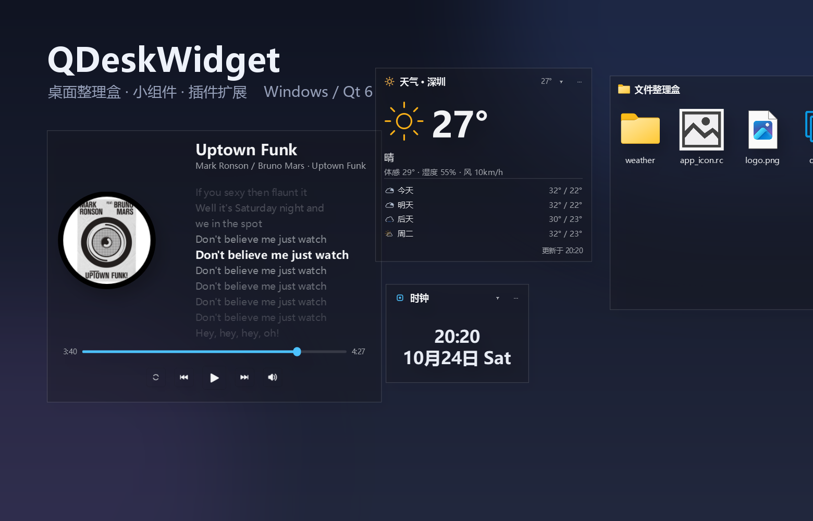

# QDeskWidget



QDeskWidget 是一款基于 **Qt 6 / C++** 的 Windows 桌面整理工具，把桌面图标收进一个个真实的文件夹盒子。

- 三种材质（亚克力 / 云母 / 纯色）+ DWM 系统圆角，无边框，托盘常驻，单实例
- 每个盒子背后是**一个真实文件夹**：可从资源管理器 / 微信 / 浏览器拖入拖出、盒内拖动排序、拖到文件夹图标上即移入
- 图标网格 / 列表 / 堆叠三种视图，手动 / 名称 / 时间 / 类型 / 大小五种排序
- 内置**天气**与**音乐**两个小组件，任意盒子可组合到同一窗口（`Ctrl+Tab` 切换成员）
- **插件机制**：实现一个 DLL 就能加自定义组件，仓库内附可直接编译的示例

---

## 构建与运行

依赖：**Qt 6.5+**（Core / Gui / Widgets / Network）、CMake 3.19+、**C++20** 编译器
（C++20 是 C++/WinRT 协程的要求，音乐组件读取系统媒体会话需要它）。

```powershell
# MinGW 示例（本机验证通过的组合：Qt 6.11.0 mingw_64 + MinGW 13.1）
cmake -S . -B build/mingw -G Ninja `
      -DCMAKE_BUILD_TYPE=Debug `
      -DCMAKE_PREFIX_PATH=D:/Qt/6.11.0/mingw_64 `
      -DCMAKE_CXX_COMPILER=D:/Qt/Tools/mingw1310_64/bin/g++.exe
cmake --build build/mingw
./build/mingw/QDeskWidget.exe
```

也可以直接用 Qt Creator 打开 `CMakeLists.txt`，选择对应 Kit 构建运行。

- **MSVC 说明**：`CMakeLists.txt` 已为 MSVC 自动加 `/utf-8 /Zc:__cplusplus /permissive-`。
  第一条必须有 —— 源码是 UTF-8，不加会被按 GBK 读，界面中文变乱码并刷 C4819。
  MinGW 与 MSVC（MSVC 19.51 + Qt 6.11.0 msvc2022_64）两套均已验证零错误零警告。
- 音乐组件只走系统媒体会话（GSMTC），**不再内置本地播放器**，因此不依赖 Qt Multimedia。
- **Windows 发布打包**：运行 `package-msvc.bat`（加 `clean` 全量重编），产出
  `dist\QDeskWidget\` 免安装自包含包 —— Release exe、Qt 运行库与 VC/UCRT 运行库
  （用户无需装 vc_redist）全部平铺在包根目录，`qt.conf` 指向同级的 `plugins\`，
  整个文件夹拷到别的机器即可运行。数据目录 `<exe 同目录>\QDeskWidget\` 随包走，
  便携形态。
  打包脚本会剪掉程序用不到的 Qt 负载（软件 OpenGL、D3D 着色器编译器、多语言翻译、
  未使用的图片格式与触摸插件），**整包约 34MB**；`icuuc.dll` 虽小但被 Qt6Core 依赖，
  不可删。

---

## 插件：自己写组件

插件就是一个 DLL，实现 `src/widgets/IWidgetPlugin.h` 里的 `IWidgetPlugin`：

```cpp
class MyPlugin : public QObject, public IWidgetPlugin
{
    Q_OBJECT
    Q_PLUGIN_METADATA(IID QDeskWidgetPlugin_iid FILE "metadata.json")
    Q_INTERFACES(IWidgetPlugin)
public:
    QString pluginId() const override { return "my-widget"; }
    QString displayName() const override { return "我的组件"; }
    QWidget *createWidget(QWidget *parent) override { return new MyWidget(parent); }
    QString widgetTitle() const override { return "我的"; }
};
```

- 接口还提供 `description()`、`badgeCount()`（标题栏计数）、`refreshWidget()`、
  `saveWidgetState()` / `restoreWidgetState()`（状态会存进 `boxes.json` 的 `widgetState`）。
- 宿主会把 `createWidget()` 返回的控件铺满内容区，组件自己管刷新定时器和内部布局。
- 编译产物放进 **`<exe 同目录>\QDeskWidget\plugins\`**（打包形态下整个 `QDeskWidget\`
  数据目录随 exe 走），然后 设置 → 组件 →「重新扫描插件」，再在下拉框里选中它、点「添加」。
- `plugins/hello-clock/` 是完整可编译的示例（一个走秒的时钟），CMake 里默认一起构建并自动拷到上述目录，
  复制整个目录改个 id 就能当自己的组件起点。

📖 **完整的插件编写文档见 [docs/PLUGIN_GUIDE.md](docs/PLUGIN_GUIDE.md)**：接口逐个说明、
控件编写规则、状态持久化、CMake 模板、安装加载与排查清单，直接照着写即可。

---

## 许可

本项目以 **MIT License** 发布，全文见仓库根目录的 [`LICENSE`](LICENSE)（Copyright © 2026 whnbd）。

**关于与 DeskBox 的关系**：本项目的定位是**独立实现**。它依照
[DeskBox](https://github.com/Tianyu199509/DeskBox)（C# / WinUI 3）所呈现的功能形态，
用 **Qt 6 / C++20** 从零实现，**未使用原项目的任何源代码** —— 两者技术栈、代码库与构建体系完全独立，
不存在代码层面的衍生关系。DeskBox 仅作为功能与体验的参照对象；本项目与原作者无隶属关系，亦未获其背书。

天气图标来自 [Meteocons](https://github.com/basmilius/weather-icons)（Copyright © 2020-present Bas Milius，MIT），
许可证原文见 `resources/weather/LICENSE.txt`，随程序一起分发即可。
