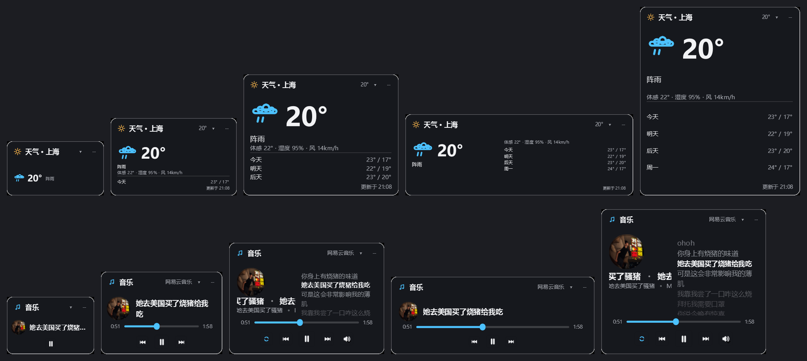
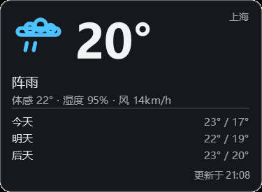
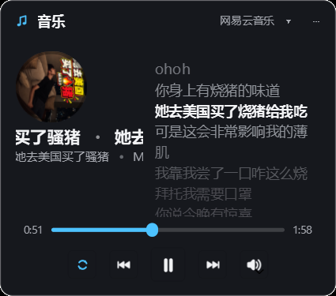
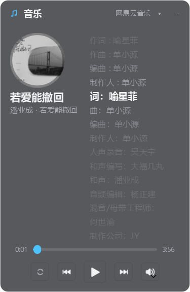
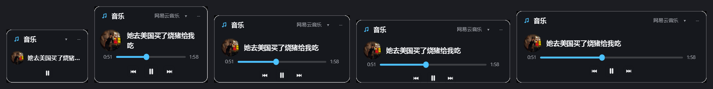
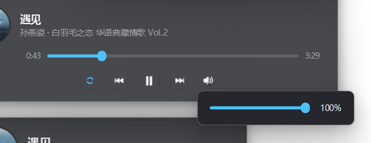

# QDeskWidget


[QDeskWidget] 是一款 C++ / qt6 的 Windows 桌面整理工具。

- 亚克力 / 云母 / 纯色三种材质，Win11 走 DWM 系统圆角，无边框，不抢任务栏
- 每个整理盒背后是**一个真实文件夹**（可托管新建，也可关联已有文件夹），桌面文件不被搬走
- 从资源管理器 / 微信 / 浏览器拖进来，拖出去，盒内拖动排序，拖到文件夹图标上即移入
- 图标网格 / 列表 / **堆叠**三种视图，手动 / 名称 / 时间 / 类型 / 大小五种排序
- **天气 / 音乐** 两个内置小组件（音乐支持封面/歌词/进度/循环/音量），**任何盒子都能组合到一个窗口**（`Ctrl+Tab` 切成员）
- 组件**版式随尺寸分档**：窗口大小的改变会切换到不同版式（而非把控件硬缩小），文字与图标不会被裁切或遮挡
- 组件可**隐藏标题栏**，让内容铺满整窗（隐藏后在空白处直接拖动移动、右键出菜单）
- 所有盒子 / 组件都能**锁定大小**，锁定后拖边框不再改变宽高
- **手动堆叠**：选几个文件右键「叠成一堆」，盒子里只显示一张叠卡 + 数量角标，双击展开
- **插件机制**：自己写一个 DLL 就能加组件（附可直接编译的示例）
- 标题栏拖动移动、双击改名、一键折叠成标题条
- 托盘常驻、单实例、布局与状态全部本地持久化

---

## 构建与运行

依赖：**Qt 6.5+**（Core / Gui / Widgets / Network）、CMake 3.19+、**C++20** 编译器
（C++20 是 C++/WinRT 协程的要求，音乐组件读取系统媒体会话需要它）。

```powershell
# MinGW 示例（本机验证通过的组合：Qt 6.11.0 mingw_64 + MinGW 13.1）
cmake -S . -B build/mingw -G Ninja `
      -DCMAKE_BUILD_TYPE=Debug `
      -DCMAKE_PREFIX_PATH=D:/Qt/6.11.0/mingw_64 `
      -DCMAKE_CXX_COMPILER=D:/Qt/Tools/mingw1310_64/bin/g++.exe
cmake --build build/mingw
./build/mingw/QDeskWidget.exe
```

也可以直接用 Qt Creator 打开 `CMakeLists.txt`，选择对应 Kit 构建运行。

- **MSVC 说明**：`CMakeLists.txt` 已为 MSVC 自动加 `/utf-8 /Zc:__cplusplus /permissive-`。
  第一条必须有 —— 源码是 UTF-8，不加会被按 GBK 读，界面中文变乱码并刷 C4819。
  MinGW 与 MSVC（MSVC 19.51 + Qt 6.11.0 msvc2022_64）两套均已验证零错误零警告。
- 音乐组件只走系统媒体会话（GSMTC），**不再内置本地播放器**，因此不依赖 Qt Multimedia。
- **Windows 发布打包**：运行 `package-msvc.bat`（加 `clean` 全量重编），产出
  `dist\QDeskWidget\` 免安装自包含包 —— Release exe、Qt 运行库与 VC/UCRT 运行库
  （用户无需装 vc_redist）全部平铺在包根目录，`qt.conf` 指向同级的 `plugins\`，
  整个文件夹拷到别的机器即可运行。数据目录 `<exe 同目录>\QDeskWidget\` 随包走，
  便携形态。

### MSVC 增量构建的坑（重要）

`build-msvc.bat` 是一键脚本，`build-msvc.bat clean` 是全量重建。它除了省去手配
`INCLUDE` / `LIB` / `PATH`（本机 `reg.exe` 受限，`vcvars64.bat` 拿不到完整 SDK 路径），
还绕开了一个很隐蔽的问题：

**中文版 MSVC 的 `/showIncludes` 输出是「注意: 包含文件:」，而 CMake 只认
`Note: including file:`。** 于是 NMake 工程里头文件依赖**全部丢失** ——
`compiler_depend.internal` 里每个 `.obj` 只登记了 `.cpp` 自己，改头文件不触发重编。

这在「基类新增虚函数」时是致命的：派生类的虚表用旧头文件生成，比调用方预期的少一项，
运行期 `call [vtable+0x1A8]` 取到 0，直接跳到空地址。2026-10-24 那次
`QDeskWidget.exe terminated abnormally` 就是这么来的：

```
0x0                                   ← 跳到空地址
FileBoxWindow::updateHeader+0x56f     ← m_panel->setHeaderHidden() 的虚调用
FileBoxWindow::applyAppearance
FileBoxWindow::FileBoxWindow          ← 构造期就崩，一启动就退
```

`WidgetPanel.h` 新增了 `maximumSizeHint()`，`FileBoxWindow.cpp` 重编了，
而 `WeatherWidget.cpp` 还是四小时前的 `.obj`，它的 vtable 比调用方少一项。

现在 `CMakeLists.txt` 里加了「头文件戳」：所有源文件都 `OBJECT_DEPENDS`
一个 `qdw_headers.stamp`，任意 `src/**/*.h` 变动就整体重编一次（实测：改一个头文件重编 28 个目标，
不改动重编 0 个）。该机制只在 MSVC 分支启用，MinGW / Ninja 本来就靠 `-MD` 有正确的头依赖。

> 同样的坑对任何 CMake + 中文版 MSVC 的 NMake 工程都成立。

开发自检参数：

| 参数 | 作用 |
| --- | --- |
| `--grab <目录>` | 把每个盒子用 `QWidget::grab()` 渲染成 PNG 后退出（组合窗口会逐个成员各存一张） |
| `--material-seq 2,1,0,1 --out <目录>` | 依次切换材质（0 亚克力 / 1 云母 / 2 纯色）并截图，同时记录每步 DWM 背板类型 |
| `--vol-probe <appId>` | 读该播放器的会话音量 → 设为 30 → 再读回 → 还原，用来验证 Core Audio 通路 |
| `--new-widget <kind> [--new-widget-plugin <id>]` | 走「添加组件」的同一条路径建一个组件盒子，用来验证「以最小尺寸落地」 |
| `--settings` | 直接打开设置对话框（菜单里的入口只能靠鼠标点，命令行没法触发） |
| `--theme-flip <毫秒>` | 到点切一次主题并刷新所有窗口，用来验证组件面板有没有重新上色（配 `--grab` 比对前后两张图） |

`--material-seq` 是为此前的「切到云母变不透明」问题加的自检：日志里 `backdrop` 恒为 `1`（NONE）才说明状态是干净的。

---

## 材质与圆角

| 材质 | 实现 |
| --- | --- |
| 亚克力 | `SetWindowCompositionAttribute(ACCENT_ENABLE_ACRYLICBLURBEHIND)`，对窗口背后实时模糊 |
| 云母 | 更薄的染色 + 同一套模糊；视觉上更接近壁纸取色 |
| 纯色 | 关闭模糊，只画一层半透明底色（底色更厚） |

材质的施加入口只有一个：`Platform::applyMaterial()`。**整理盒和设置面板都走它**，
所以三档材质在两个地方表现一致（设置面板见「面板本身也是玻璃」）。

**为什么以前从「纯色」切到「云母」会变不透明**：旧实现里云母分支会给窗口打
`DWMWA_SYSTEMBACKDROP_TYPE = DWMSBT_MAINWINDOW`。Qt 的 `WA_TranslucentBackground` 底层是
`WS_EX_LAYERED`，DWM 的系统背板在分层窗口上会和 `SetWindowCompositionAttribute` 抢合成：

- 从**亚克力**切过去：强调色一直在线，背板被盖住，看起来还是透明的；
- 从**纯色**切过去：强调色刚被 `ACCENT_DISABLED` 关掉，DWM 背板抢到了合成权，于是整块变成不透明的
  Mica 背板 —— 这就是那次「切换后不透明」的真正原因。

现在的做法是**每次切换都先归一化状态**：先 `setBackdropType(NONE)` 清掉任何残留背板，再按目标材质设置强调色；
并且**分层窗口永远不打 Mica 背板标记**（只有非分层窗口才走真正的 DWM 背板分支）。
`--material-seq` 实测三步 `云母 → 纯色 → 云母` 的 `backdrop` 全部为 `1`，屏幕截图上壁纸始终能透过来。

### 圆角只由窗口负责

**窗口里的东西一律画直角**，圆角交给窗口自己去裁：Win11 用
`DWMWA_WINDOW_CORNER_PREFERENCE = ROUND` 让 DWM 裁（边缘有抗锯齿），拿不到（Win10）时
退回 `setMask()` 蒙版。两条路径**互斥**，且半径只有一个。

> 设置里的「使用系统圆角」开关已经删掉：自绘圆角那套本来就和 DWM 打架，留着开关只会让人以为
> 关掉更好看。现在恒走系统圆角，`AppSettings::systemCorners` 字段只为兼容旧 `settings.json` 保留。

以前是「窗口圆角 + 里面再画一层 12px 圆角」：DWM 的半径约 8px、自绘的是 12px，
两圈对不上，四角就会出现「双层圆弧 + 一圈灰缝」，看着像里面又套了个框。
现在 `FileBoxWindow::paintEvent` / `SettingsDialog::paintEvent` 都是 `fillRect` + `drawRect`，
自绘的 1px 描边只负责颜色，形状完全交给窗口。

---

## 小组件

| 组件 | 能力 | 依赖 |
| --- | --- | --- |
| 天气 | 城市 → 经纬度 → 实况 + 未来三天；体感 / 湿度 / 风速；结果缓存，断网显示上次数据 | Network（Open-Meteo，免密钥）+ Svg（图标） |
| 音乐 | 接管系统全局媒体会话：歌名 / 歌手 / 专辑 / 封面 / 进度 / 同步歌词，可直接播放暂停、上下曲、拖进度；也能切换优先显示哪个播放器 | GSMTC（Win11 + MSVC）+ 歌词源（网易云） |

两个组件都用统一的面板基类 `WidgetPanel`：只负责内容区，玻璃背景、圆角、标题栏、折叠全部由窗口统一处理，
所以它们天然支持折叠、置顶、组合。

面板如果把颜色缓存在控件里（QSS、`setTextColor()`、染色图标），换主题**不会自动变**：
这些颜色在设置那一刻就固定了。所以 `WidgetPanel` 留了一个 `applyTheme()` 钩子，
`FileBoxWindow::applyAppearance()` 每次都会调它；音乐组件在里面重设 QSS / 歌名歌手色 / 歌词配色 / 三个按钮的染色图标。
完全自绘的面板（天气）在 paintEvent 里现读 `AppSettings`，不需要覆写。

> 这个坑的典型症状：深色主题下音乐组件的文字还是黑的（反过来就是浅色主题下白字看不见）。

**组件的唯一入口是设置面板**（设置 → 组件 →「添加组件」下拉框 →「添加」）：
托盘菜单和盒子右键菜单里只留「新建整理盒」。原因是菜单里挂一长串组件 + 插件子项，
装几个插件之后就长得放不下了；放进设置面板后还能顺带显示描述、支持「重新扫描插件」「打开插件目录」。

## 组件随尺寸换版式

组件不会把控件硬缩小去塞进小窗口，而是按可用宽高**换一套版式**。窗口的下限就是
`WidgetPanel::minimumSizeHint()`（组件自己给出），所以再怎么拖也不会出现文字被裁掉、按钮叠在一起。



| 组件 | 小尺寸 | 中等 | 大尺寸 | 宽扁 |
| --- | --- | --- | --- | --- |
| 天气 | 一行「图标 + 温度 + 天气」 | 图标 + 温度 + 描述 + 体感/湿度 + 逐日列表 | 字更大、行距按余量均分，今天/明天/后天/周一四行 | 左右两栏：左边温度，右边详情与预报 |
| 音乐 | **左列只放封面，右列放歌词 + 控制**（歌名区让位给歌词） | 封面 + 当前歌词（可折 2 行）+ 进度条 | 封面 + 歌名/歌手在下方 + 右侧多行歌词（6~8 行），进度与控制贴底 | 宽而高时同「大」；矮到放不下时退回「左封面 + 右单行歌词」 |

- **天气组件是逐帧自绘的**：图标是内置的 SVG 矢量图（见下一节），文字按可用空间量算并逐行 elide，
  所以任何尺寸都能精确排布，不会出现控件挤压；逐日行高不足 16px 时自动省掉小图标，只留文字更清楚。
- **音乐组件用 `QGridLayout` 按档位重排**：封面尺寸、字号、歌词行数、进度条/时间/上下曲/来源按钮的可见性都由档位决定；
  歌词区没有内容时自动收起，进度与控制在底部对齐。
  封面按档位取 **24 / 34 / 42 / 44 / 66 / 86** 六档（不随高度连续变化，避免缩放时反复重排）。
  **任何尺寸下都保留进度条与控制按钮**：空间不够时先压边距和按钮尺寸，最后才降封面档。
- **缩放时不抖动**：所有尺寸参数都是**离散档位**（没有 `h * 0.36` 这类连续公式），档位内 resize 不触发任何重排；
  跨档时也只把新档位标记出来，实际重排合并到事件循环空闲时执行一次；
  歌词视图的字号没变就不再重新折行（这是拖边缘时最费时的操作）。
- **标题栏也会自适应**：宽度不足 250px 时收起「N 项 / 20°」这类徽标，不足 215px 时再收起组合徽标，优先保证标题能显示。

## 折叠 / 展开动画

点标题栏 `▾` 或在折叠态点标题栏，窗口高度会在 **180ms（OutCubic）** 内平滑变化，收起时是「卷帘」效果：
内容不重排、只是被变矮的窗口逐渐裁掉。

实现要点（`FileBoxWindow::startCollapseAnimation`）：

| 点 | 做法 |
| --- | --- |
| 动画对象 | `QPropertyAnimation(this, "geometry")`，起止 rect 的左上角相同，所以只变宽高不变位置 |
| 内容不重排 | 动画期间把内容控件 `setFixedHeight(展开时内容高)`，窗口变矮时它被**裁掉**而不是被压扁——组件面板重排一次要几十毫秒，跟着动画重排会抖成幻灯片 |
| 尺寸限制 | 动画前把 `minimumSize` 放开到 `min(起,止)`、`maximumSize` 放到最大，否则中间帧会被夹住（折叠态的 `setFixedHeight` 尤其致命） |
| 防纠偏 | `m_animating` 期间 `resizeEvent` 直接返回：否则那里「折叠态高度必须等于标题栏高度」的纠偏会在第一帧就把动画按回去 |
| 收尾 | 解除内容高度锁定 → 按目标状态隐藏内容 → `applyGeometryForState()` 重建上下限 → 刷表面 → `persist()` |

> 坑：`m_animating` 必须**在第一次 resize 之前**置位。先 `resize(from)` 再置位的话，那次回退会被 resizeEvent 的折叠纠偏抓住，
> 顺手把 `maximumHeight` 钉死，之后动画每帧都被夹，表现为「收起一步到位、展开却有动画」这种单向失效。

## 天气图标

天气图标不再手绘，改用 **[Meteocons](https://github.com/basmilius/weather-icons)**（Bas Milius，MIT）的 `line`
变体，随程序编译进资源（`:/weather/*.svg`），离线可用、任意尺寸都按同一份几何缩放。

| 项 | 说明 |
| --- | --- |
| 数量 | 12 张，覆盖 WMO 天气代码全部分组（晴 / 晴间多云 / 多云 / 阴 / 雾 / 毛毛雨 / 雨 / 雪 / 阵雨 / 阵雪 / 雷雨 / 雷暴冰雹） |
| 体积 | 合计约 26 KB（文本 SVG，rcc 压缩后更小） |
| 图层 | `WeatherIcons::paint()`：按主题查模板 → 栅格化成 `QPixmap`（带 `devicePixelRatio`）→ 缓存 → `drawPixmap` |

入库前对原始 SVG 做了 4 处加工（一次性脚本完成，不参与构建，`CMakeLists.txt` 里有说明）：

1. **删掉 SMIL 动画**：QtSvg 不播放，留着是死代码；
2. **删掉 `<mask>`**：QtSvg **不支持 mask**（带 `mask="url(#…)"` 的组会被整组丢弃，太阳直接消失），
   去掉后太阳先画、云后画盖上去，视觉等价；
3. **`viewBox` 收到 `16 16 96 96`**：12 张图的墨迹都落在 128×128 画布的这一个方框内，去掉四周空白后
   图标在同一个 `m.glyph` 方框里的视觉大小才一致；
4. **颜色令牌化**：可变颜色写成 `@CLOUD@ / @CLOUD2@ / @CLOUD3@ / @RAIN@`，运行时按主题替换——
   原版云朵是近白色 `#e6effc`，在**浅色主题**下会整块隐形，所以浅色主题换成石板灰 `#c3d4e8`，
   深色主题则把雨滴从深蓝 `#0a5ad4` 提亮到 `#3f8efc`。

> 缓存键 = 图标 + 边长 + DPI + 主题，最多留 96 张（拖边框时边长连续变化，无上限会吃内存）。

## 空状态

没有任何整理盒时，程序只保留托盘图标，**不会自动创建一个空盒子**。
需要新盒子时：右键托盘 →「新建整理盒…」。**组件 / 插件不在菜单里**，统一去 设置 → 组件 →「添加」（见下）。

## 隐藏标题栏

组件的标题栏菜单里有「隐藏标题栏」。隐藏后内容铺满整窗（天气会自己在右上角补一个城市小标签）：



- 移动：在**空白处直接左键拖动**即可（同样是拖动跟手、松手对齐网格）（封面、歌词、自绘区域都算空白）；
  落在按钮、进度条、输入框这类可交互控件上时不会拖走窗口，需要拖任意位置就按住 **Alt**；
- 菜单：在窗口任意位置右键；
- 恢复：右键 →「显示标题栏」，或菜单里的同名勾选项。
- 隐藏期间折叠相关菜单项会自动收起（没有标题栏就没法展开），开启隐藏时若处于折叠态会先展开。

## 组件尺寸上下限

组件自己决定最小与最大尺寸：

| 组件 | 最小（内容区） | 最大（内容区） | 依据 |
| --- | --- | --- | --- |
| 音乐 | 168×76 | 880×680 | 再大只剩空白 |
| 天气 | 142×64 | 480×360 | 内容量固定：头部约 200px + 逐日 4 天 × 48px，字号在内容区高 190 处就封顶了 |
| 其它 / 插件 | 150×80（基类默认） | 不限 | 覆写 `maximumSizeHint()` 即可收紧 |

窗口在 `resizeEvent` 里会再夹一次，所以系统拖拽、外部 SetWindowPos、程序内部调整都不会越界。
实测天气盒子：压到 60×60 → 弹回 142×106，拉到 2000×1600 → 收在 480×402（都含 42px 标题栏）。

**新建组件一律以最小尺寸落地**（不铺开一大块空白）：

- `BoxManager::createWidget()` 只给 120×80 这个「小于任何组件」的初值，窗口构造时
  `applyGeometryForState()` 会自动夹到面板下限；
- `App::createWidgetBox()` 建完窗口后再调一次 `FileBoxWindow::shrinkToMinimum()` 兜底
  （万一某个插件的最小尺寸比 120×80 还小）。
- 实测：新建天气 = 142×106（142×64 内容 + 42 标题栏），新建音乐 = 168×118（168×76 + 42）。
  自检参数：`--new-widget 2`（天气）/ `--new-widget 3`（音乐）。

## 设置面板

**改了就生效**，不用点确定（只有「完成」按钮负责关闭）。为了拖滑块时不吃满 CPU，做了三层节流：

- 滑块（不透明度 / 图标大小）走 `applyLive()`：只写内存 + 让窗口重画，**不落盘**；
  连发的 `valueChanged` 合并到 **33ms** 一次（约 30fps）的刷新；
- 停手 **350ms** 后才写一次 `settings.json`（实测拖 24 步只写 1 次，以前是 24 次）；
- 主题没变就不重套对话框 QSS —— 重新解析样式表 + 全量子控件重绘，是拖滑块时最贵的一步；
- 下拉框 / 勾选框这类离散控件仍然立即落盘。

信号也只发一个：`App` 把 `appearanceChanged` / `behaviorChanged` 接到同一个槽，
两个都发等于把所有窗口的外观刷两遍。

> 「折叠时显示为胶囊」这个开关已经删掉 —— 胶囊模式早已移除，留着只会让人以为还能开。

### 组件分区

| 控件 | 作用 |
| --- | --- |
| 下拉框 | 内置组件（天气 / 音乐）+ 已加载插件，插件项带「（插件）」后缀 |
| 「添加」 | 发 `widgetAddRequested(kind, pluginId, title)`，由 `App::createWidgetBox()` 建窗（按最小尺寸落地），面板**不关**，可以连着加 |
| 下方 hint | 当前选中组件的说明；添加后变成「已添加「xxx」」 |
| 「重新扫描插件」 | `WidgetRegistry::reloadPlugins()` 后重填下拉框 |

> 打开面板时**只读注册表缓存、不重扫**：`reloadPlugins()` 会卸载已加载的插件，
> 正在运行的插件面板会跟着失效。新拷进去的 DLL 点一下「重新扫描插件」就出来了。

### 面板本身也是玻璃

设置面板和整理盒走**同一套表面方案**（`WA_TranslucentBackground` + 系统背板），
所以换材质 / 主题 / 不透明度时，它是跟着一起变的：

| 部分 | 做法 |
| --- | --- |
| 窗口底 | 分层窗口 + `Platform::applyMaterial()`；QSS 里 `QDialog{background:transparent;}`，底色由 `paintEvent` 自绘 |
| 染色 | 与 `FileBoxWindow::paintEvent` 同一个公式（云母 ×0.5、纯色 ×1.12），只是**多一道 alpha 下限 150**——面板全是小字，比「图标 + 文件名」的盒子更需要底子 |
| 标题栏 | **自绘**（`SettingsHeader`，无边框窗口）：左「设置」+ 右「×」，和内容画在同一块玻璃上，中间没有分界 |
| 圆角 | 同上「圆角只由窗口负责」；无边框窗口不会自动获得 DWM 圆角，`applySurface()` 里显式要求 |
| 拖动 / 缩放 | 拖动在 `SettingsHeader`（记「窗口左上角 − 全局鼠标」的差值）；缩放靠 `nativeEvent` 的 `WM_NCHITTEST` |

> 为什么不用系统标题栏：那块是 DWM 单独绘制的不透明区域，颜色和下面半透明的客户区永远对不上，
> 中间必然有一道分界。自绘之后两者共用同一块玻璃，看起来才是一体的（代价是拖动/关闭/缩放要自己写）。
>
**下拉框的箭头也是自绘的**（`UiStyle::StyleComboBox`）：QSS 一旦给 `::drop-down` 写了规则，
样式引擎就不再画默认箭头，而 `::down-arrow` 必须配 `image:` 才画得出来——所以直接画两条折线，
颜色取自 `subTextColor()`，明暗两套主题都不用额外资源。
另外系统那套箭头区是「一块比输入框更深的底 + 一条竖直分隔线」，去掉之后才是「一张输入框 + 一个箭头」。

> 两个实测出来的坑：① 只靠 `DWMWA_USE_IMMERSIVE_DARK_MODE` 在分层窗口上不可靠，系统标题栏会留在浅色，
> 所以那版方案额外用 `CAPTION_COLOR / TEXT_COLOR / BORDER_COLOR` 钉死（现在无边框了，这段逻辑留给普通窗口用）；
> ② 无边框窗口默认**没有 `WS_THICKFRAME`**，哪怕 `WM_NCHITTEST` 返回了 `HTRIGHT`，
> 系统也不会进入缩放循环 —— 拖右边缘纹丝不动。`applySurface()` 里补上这个样式位才能真正拉伸。

## 锁定大小

所有整理盒和组件都能锁定尺寸：右键（或标题栏 `⋯`）→「锁定大小」。

- 锁定后窗口边缘不再响应拖动缩放（`WM_NCHITTEST` 直接返回 `HTCLIENT`），但仍可移动、折叠、改成员；
- 状态存在 `boxes.json` 的 `lockSize` 里，重启后保持；
- 想恢复拖动缩放，再点一次取消勾选即可（会重新按组件的 `minimumSizeHint()` 计算最小尺寸）。

### 拖边框缩放的命中区

无边框窗口没有系统边框，缩放热区全靠 `WM_NCHITTEST` 自己算，两个细节决定「好不好拉」：

- **热区按 DPI 放大**：边上 8 逻辑像素（≈ Windows 标准尺寸边框 `SM_CXSIZEFRAME + SM_CXPADDEDBORDER`），
  四角放宽到 **2 倍**（16 逻辑像素）。以前全用 6px，角上要正好点在 6×6 的小方块里，斜拉基本点不中。
- **缩放后立刻落盘**：`resizeEvent` 里用 250ms 单次定时器合并写盘（拖动边框会连续触发几十次，
  不能每次都写 JSON）。在此之前只有移动会 `persist()`，拉完尺寸重启又回到旧值，手感上就像「拉了没用」。

回到「锁定大小」那条：被锁定的盒子无论怎么拉都不会动，这是有意的 —— 想要能拉就先取消勾选。

## 音乐组件

音乐组件默认不是「自己放歌」，而是**接管 Windows 全局媒体会话（GSMTC）**：只要系统里任何一个播放器在放歌，
它就能显示并控制，不需要那个播放器提供 SDK。

**版面只有两档**（判定：内容区宽 ≥ 320 且高 ≥ 230 走大档，否则小档）：

| 档 | 尺寸量级 | 排法 |
| --- | --- | --- |
| 小档 | ≈ 384×166 这种扁条 | 封面在左单列，右列「歌词 / 进度条 / 控制」三件套整体垂直居中 |
| 大档 | ≈ 380×290 往上 | 网易云式：左边大封面竖跨，右侧上歌名下歌词，底部进度条 + 控制横贯整行 |

**字号跟着尺寸连续变，不分档**：每档内部按内容区高度做线性插值
（大档 230→800、小档 84→230 映射到 0→1），歌名 / 歌手 / 歌词 / 时间 / 按钮 / 图标 / 间距一起缩放：

- 大档：歌名 18→32px、歌手 11→16px、歌词 14→22px、按钮 28→42px；
- 小档：歌名 12→15px、歌词 13→16px、按钮 20→28px。

字号必须是整数 px，所以只有真的跨过 1px 才触发重排，重排次数仍然有限，拖动时不会逐像素抖动。
**封面是唯一例外**：换直径要重新裁圆（最贵的一步），保持离散档位（110 / 130 / 150 / 180）。

大档（`underCover`）：



- 左侧：**圆形封面**，外面包一圈**实心黑色圆环**（厚度按直径取 2–8px，像黑胶唱片边），
  直径 110 / 130 / 150 按高度分三小级；**播放时缓慢旋转**（约 11 秒一圈），暂停就定格，
  黑环不跟着转所以不会晃；封面在「歌名 + 歌词」这块里垂直居中；
- 右列上方：歌名 +「歌手 · 专辑」；**太长时自动横向滚动**（跑马灯），两遍之间有个小圆点分隔；
- 右列下方：歌词区（见下），富余高度全给它；
- 进度：`已播` 在左、`总长` 在右，中间滑条可拖动定位，**横贯整行**贴底；
- 控制：`循环` `上一首` `播放/暂停` `下一首` `音量` **整行居中**；图标按主题色着色（QStyle 默认图标在暗色玻璃上偏黑，直接用会看不见）。
  音量按钮挂了弹出面板，`QToolButton` 会给带 menu 的按钮自动画一个下拉小三角，
  这个按钮按下即弹、没有「点箭头才弹」的语义，所以用样式表把 `menu-indicator` 关掉了。

**歌词**（`LyricsView`，自绘）：



- 按当前宽度**自动折行**，长句不会只显示半截；
- **水平对齐跟着版式走**：大档**左对齐**（首行左边缘和上方的歌名/歌手落在同一条竖线上），
  小档**居中**（没有歌名做参照，居中更耐看）。由 `LyricsView::setTextAlignment()` 控制；
- **大档带网易云那种歌词页交互**（`setSeekable(true)`）：
  - **时间胶囊按需出现，平时收起**：默认不占位置；鼠标在歌词上**滚动一下**才在**右侧**展开，
    而且只画在**鼠标悬停的那一行**上 —— 不是每行都挂一串时间；
    鼠标移开或停手 3 秒自动收起（`setTimeColumnVisible()`）；
  - 时间做成**胶囊**：圆角 = 高度一半，极淡底色 + 同色描边，宽度按 `88:88` 固定（各行不跳动）；
  - **只有点右侧的胶囊才跳转**（`seekRequested` → GSMTC `seek`），点歌词正文没有反应，
    手型光标也只在胶囊上出现；点完立刻恢复跟随，不会停在用户翻到的位置；
  - 胶囊展开时正文要给右侧让出宽度，所以会重折行一次 —— 但**不重算滚动目标**，
    否则用户刚翻到的位置会被拽回「当前句居中」；
  - **滚轮可以手动翻阅**，一格一行；停手 2.5s 自动回到跟随当前句；
  - 这些控件自己吃鼠标，所以「隐藏标题栏」时点歌词不会变成拖窗口
    （通过 `qdwInteractive` 动态属性告诉拖动过滤器）；
  - 小档保持纯展示：没有时间列、不吃鼠标，点在歌词上仍然可以拖窗口；
- 显示当前句 + 上下文多行；**当前句加粗且字号更大，唱过/没唱到的行小一号**，离得越远越淡；
- 多行时当前句居中（上下都能看到上下文），歌词不足一屏时整体垂直居中，不会全部贴顶；
- 换句时用 220ms 的缓动平滑滚动，不是硬跳；
- 歌词区会一直延伸到进度条上方，窗口越高能看到的句子越多；
- 没有歌词时显示「歌词加载中… / 暂无歌词」，没在播放时显示提示语（小档下另见下条）。

小档（`lyricOverInfo`）：



- **左列只有封面（基准直径 58），右列自上而下是「歌词 / 进度条 / 控制按钮」**；
  - 封面竖跨整块内容区、上下居中；高度不够才一档档下压（46/34/24）；
  - 三件套上下各有一条等权重留白，所以作为一块整体在内容区里垂直居中；
- **这个版式不显示歌名块** —— 高度就这么多，留给歌词更值；没有歌词（未播放 / 加载中 / 暂无）时
  由兜底文案顶上「歌名 · 歌手」，信息不会丢；
- 只显示当前句，长句照样按宽度折行（高度只够一行时压成一行 + 省略号）；
- **字号比大档再大一档**（15px，极小窗口 13px）—— 这个版式行数少，不放大的话在角落看不清；
- 拖大到大档阈值就自动切成大档，不用手动切换。

**循环播放**：点循环按钮在 顺序 → 列表 → 单曲 之间切换，右键菜单里也能选。
| 模式 | 行为 |
| --- | --- |
| 顺序播放 | 不干预，播完由播放器自己决定 |
| 列表循环 | 播放器停在末尾时，组件替它拉下一首并继续播 |
| 单曲循环 | 快播完时 `seek(0)`，只依赖 seek 接口，任何播放器都生效 |

**音量**：点音量按钮弹出滑条（也可以直接在按钮上滚轮，±5%）。调的是**该播放器自己的音频会话音量**，
不是系统总音量 —— 走 Windows Core Audio（`IAudioSessionManager2` + `ISimpleAudioVolume`），
按 appId 匹配进程后单独设置；找不到对应会话时自动退化成系统音量，并在按钮提示里说明。



**进度同步**：位置有两条来源，谁也不等谁。

- 权威值：GSMTC 每 500ms 轮询一次 `GetTimelineProperties()`，并用 `LastUpdatedTime` 补掉
  「播放器上报那一刻到此刻」的延迟（只在建新锚点时补，否则暂停时长会被算成播放时长）；
- 中间值：组件自己跑 **100ms 心跳**，用单调时钟从最近一次权威值往后推，进度条不会一格一格跳。
  这个节拍也决定歌词换句的响应速度 —— 以前是 300ms，最坏要晚 300ms 才切过去，
  对着播放器就能看出「组件慢一拍」，压到 100ms 后滞后缩到一帧级；
- 两端时间文本只在**秒数变化**时重设，不然 10Hz 心跳会把进度行重排 10 次/秒；
- 封面做逐字节去重：轮询每 500ms 会把同一张图再送一遍，不去重就是每 500ms 解码一次图片、
  重裁一次圆形封面（平滑缩放最贵），既白烧 CPU 又会在 GUI 线程上周期性卡一下。

| 部分 | 来源 |
| --- | --- |
| 歌名 / 歌手 / 专辑 | SMTC 的 `MediaProperties` |
| 封面 | SMTC 缩略图（`TryGetThumbnailAsync`），裁成圆形 |
| 进度 | SMTC 时间线 + 本地单调时钟平滑（只在「两次观测都在播放」时推进，暂停不会把暂停时长算进去） |
| 歌词 | 按「歌名 + 歌手」去网易云公开接口搜曲取 LRC，解析时间轴后跟随进度高亮当前行 + 下一行 |
| 播放 / 暂停 / 上一首 / 下一首 | SMTC 的 `TryTogglePlayPauseAsync` / `TrySkipNextAsync` / `TrySkipPreviousAsync` |
| 拖进度 | SMTC `TryChangePlaybackPositionAsync`（播放器不支持时自动忽略） |
| 循环 | 组件自己的播放策略（seek 回开头 / 拉下一首），见上表 |
| 音量 | Windows Core Audio 的会话音量（`ISimpleAudioVolume`），按播放器进程匹配 |

**切换优先显示哪个播放器**：只在**右键菜单 →「优先显示哪个播放器」**里选（界面上不再占用按钮）。
列表来自 `SessionManager.GetSessions()`，可以选「跟随系统当前会话」，也可以钉死某个播放器（同时开着网易云和浏览器时很有用）。
选择会写进 `BoxConfig.widgetState.appId`，并作为全局默认存进 `settings.json` 的 `musicAppId`。

**如果显示「未检测到媒体会话 / 系统媒体会话无响应」**：说明 Windows 的 SMTC broker 卡住了
（`GlobalSystemMediaTransportControlsSessionManager::RequestAsync()` 不返回）。这是系统侧故障，
换任何程序都一样 —— 表现为所有播放器都不再上报到系统媒体浮窗。`RequestAsync` 有 5 秒看门狗 + 一次重试，
所以界面会明确提示而不是一直停在「未在播放」。恢复办法：重启播放器，或注销 / 重启电脑。

**构建要求**：GSMTC 走 C++/WinRT，只有在 **MSVC** 下才会编译（`QDW_HAS_GSMTC`），并链接 `windowsapp.lib`；
由于用到了协程，项目标准已提到 **C++20**。MinGW 构建会跳过这块，音乐组件会提示「系统媒体会话不可用」。

## 组合（Group）

任何一个盒子的标题栏菜单 → **组合 → 加入组合**，就能把别的盒子（文件盒或组件都行）并进同一个窗口：

- 标题栏出现 `2/3` 成员徽标；
- `Ctrl+Tab` / `Ctrl+Shift+Tab` / `Ctrl+PgDn` / `Ctrl+PgUp` 切换，**在标题栏上滚轮**也能切；
- 每个成员保留自己的文件夹、视图、排序、组件状态，切回去还是原样；
- 成员被组合后不再单独占一个窗口，移出后回到原来的位置；
- 一个盒子只能属于一个组合；删掉组长会连同成员一起删除，删成员则会自动从组合里摘掉。

## 手动堆叠

选中一个或多个文件 / 文件夹 → 右键 **「把选中的 N 项叠成一堆…」**：

- 实际做法是在盒子目录里建一个 `名字.pile` 文件夹，把选中的东西移进去 —— 仍然是普通文件夹，
  资源管理器里能直接看到，也方便备份；
- 网格里它显示成**三层错位卡片 + 数量角标**，不再是普通文件夹图标；
- 双击用和堆叠视图同一个弹出窗口展开（3×3 / 5×5，可拖出、打开、重命名、删除）；
- 右键堆 → **拆开这一堆**，内容移回盒子并删除空的 `.pile` 目录。

## 插件：自己写组件

插件就是一个 DLL，实现 `src/widgets/IWidgetPlugin.h` 里的 `IWidgetPlugin`：

```cpp
class MyPlugin : public QObject, public IWidgetPlugin
{
    Q_OBJECT
    Q_PLUGIN_METADATA(IID QDeskWidgetPlugin_iid FILE "metadata.json")
    Q_INTERFACES(IWidgetPlugin)
public:
    QString pluginId() const override { return "my-widget"; }
    QString displayName() const override { return "我的组件"; }
    QWidget *createWidget(QWidget *parent) override { return new MyWidget(parent); }
    QString widgetTitle() const override { return "我的"; }
};
```

- 接口还提供 `description()`、`badgeCount()`（标题栏计数）、`refreshWidget()`、
  `saveWidgetState()` / `restoreWidgetState()`（状态会存进 `boxes.json` 的 `widgetState`）。
- 宿主会把 `createWidget()` 返回的控件铺满内容区，组件自己管刷新定时器和内部布局。
- 编译产物放进 **`<exe 同目录>\QDeskWidget\plugins\`**（打包形态下整个 `QDeskWidget\`
  数据目录随 exe 走），然后 设置 → 组件 →「重新扫描插件」，再在下拉框里选中它、点「添加」。
- `plugins/hello-clock/` 是完整可编译的示例（一个走秒的时钟），CMake 里默认一起构建并自动拷到上述目录，
  复制整个目录改个 id 就能当自己的组件起点。

📖 **完整的插件编写文档见 [docs/PLUGIN_GUIDE.md](docs/PLUGIN_GUIDE.md)**：接口逐个说明、
控件编写规则、状态持久化、CMake 模板、安装加载与排查清单，直接照着写即可。

---

## 交互一览

| 操作 | 效果 |
| --- | --- |
| 拖动标题栏 | 移动盒子（拖动过程 1:1 跟手，松手后对齐 16px 网格） |
| 双击标题 | 就地改名 |
| 折叠状态下点标题栏 | 展开 |
| 标题栏 `▾` | 折叠成标题条（180ms 卷帘动画，展开同理） |
| 标题栏 `⋯`、标题栏右键 | 盒子菜单（改名、查看方式、排序、图标大小、折叠样式、组合、置顶、删除…） |
| `Ctrl+Tab` / `Ctrl+Shift+Tab` | 组合内切换成员 |
| 音乐组件「音量」按钮 | 弹出音量滑条（滚轮 ±5%） |
| 音乐组件「循环」按钮 | 顺序 / 列表 / 单曲 循环 |
| 隐藏标题栏后左键拖动 | 移动窗口（按钮/滑条上除外；`Alt` + 拖动可在任意位置移动，右键出菜单） |
| 标题栏滚轮 | 组合内切换成员 |
| 堆叠视图点击卡片 | 弹出 3×3 / 5×5 网格窗口（`Esc` 或点窗口外关闭） |
| 双击 `.pile` 堆 | 用同一个弹出窗口展开这一堆 |
| 选中后右键「叠成一堆…」 | 把选中的项目打成一个堆 |
| 双击文件 / 文件夹 | 用默认程序打开 / 打开文件夹 |
| 从资源管理器拖入 | 默认**复制**进盒子；按住 `Shift` 改为移动 |
| 选中后拖出 | 拖到资源管理器（走 Windows 默认移动/复制判定） |
| 盒内拖动 | 排序，自动切换为「手动」排序 |
| 拖到文件夹图标上 | 移入该文件夹（按住 `Ctrl` 为复制） |
| `F2` / `Delete` / `Enter` | 重命名 / 移到回收站 / 打开 |
| `Ctrl` + 滚轮 | 调整图标大小（32px ~ 160px） |
| 单击托盘图标 / 双击托盘图标 | 显示隐藏全部盒子 / 打开设置 |
| 再次启动程序 | 唤起已有实例并显示全部盒子，本进程退出 |

---

## 数据存放

```
<exe 同目录>\QDeskWidget\        数据随 exe 走（便携形态；旧版 %APPDATA% 数据首次启动自动迁移）
├── settings.json          全局外观 / 行为设置（含天气城市、优先播放器）
├── boxes.json             盒子布局、排序、组件状态、组合成员
├── weather_cache.json     天气组件缓存
├── plugins\               组件插件 DLL
└── storage\<boxId>\       托管盒子的真实文件夹（.pile 堆也在这里面）
```

- 托管文件夹里的文件就是普通文件，资源管理器一样能打开、改名、删除。
- 删除盒子**不会**删除托管文件夹里的文件。
- 组件的私有状态（天气城市、音乐音量、插件数据）存在各自 `BoxConfig.widgetState` 里。

---

## 目录结构

```
main.cpp                     入口：字体、数据目录、单实例、开发自检参数
src/App.*                    应用控制器：托盘、窗口生命周期、组合重建、持久化
src/core/
  Paths.*                    数据目录常量
  AppSettings.*              全局设置 + 主题色令牌
  BoxConfig.*                盒子配置（kind / 组件状态 / 组合成员）与 JSON 序列化
  BoxManager.*               盒子集合的增删存取（文件盒 / 组件）
  FileItemModel.*            文件夹内容模型（图标缓存、排序、目录监听、堆识别）
  ShellActions.*             打开 / 定位 / 回收站 / 复制 / 移动 / 重命名
  lyricfetcher.*             网易云 LRC 歌词抓取（带缓存）
  globalmediasessionlistener.*  系统全局媒体会话（C++/WinRT，仅 MSVC）
src/platform/Platform.*      Win32 材质（亚克力 / 云母 / 纯色）、DWM 圆角、背板诊断
src/platform/MediaVolume.*   按播放器调音量（Core Audio 会话音量）
src/ui/
  MarqueeLabel.*             单行文字：放不下时横向滚动
  CoverView.*                圆形封面：播放时旋转
  mrowlayout.*               横向布局容器（用户提供）
  mcolumnlayout.*            纵向布局容器（用户提供）
  UiStyle.h                  对话框 / 面板统一样式 + 表单行助手
  FileBoxWindow.*            盒子窗口 + 标题栏 + 折叠 + 组合切换 + 堆叠菜单
  FileListView.*             内容视图：拖放、内联改名、快捷键
  FileItemDelegate.*         图标网格 / 列表绘制（含堆卡与角标）
  StackView.*                堆叠卡片 + 3×3 / 5×5 弹出展开窗口
  NewBoxDialog.*             新建整理盒
  SettingsDialog.*           设置窗口
src/widgets/
  WidgetPanel.h/.cpp         组件面板基类
  IWidgetPlugin.h            插件接口（第三方 DLL 只需 include 这个头）
  WidgetRegistry.*           内置组件注册 + 插件扫描 / 创建 / 适配
  WeatherWidget.*            天气组件
  WeatherIcons.*             天气图标：SVG 资源 → 按主题染色 → 栅格化缓存 → 贴图
  MusicWidget.*              音乐组件（GSMTC 控制器 + 循环 + 音量 + 分档版式）
  LyricsView.*               歌词视图（自动折行、上下文多行、平滑滚动、矮版式下只显示当前句）
plugins/hello-clock/         示例插件（可直接复制改成自己的组件）
resources/weather/           天气图标 SVG（Meteocons line 变体，MIT，见同目录 LICENSE.txt）
```

### 布局约定

界面**不使用**裸 `QHBoxLayout` / `QVBoxLayout`，统一走两个自定义容器：

- `MColumnLayout` 作为窗口根容器：`ColumnFillHost(this)` 铺满宿主，再 `ColumnAddWidget()` 逐行追加。
- `MRowLayout` 承担每一行：标题栏是它的子类。
- **要右对齐时不要用 `RowPinToRight()`**：它补的尾部弹簧会和可拉伸控件 1:1 抢空间。
  正确写法是「可拉伸控件(stretch=1) + 其它控件 + `RowClearSpacers()`」。
- 表单行用 `UiStyle::formRow()`，按钮行用 `UiStyle::buttonRow()`。

### 代码注释约定

全项目约 1.67 万行，其中注释约 4900 行。注释写「为什么」和「约定」，不写「做了什么」：

- **文件顶部**用 `@file` 块说明本文件职责 + 关键坑（3-6 行）。
- **每个成员变量**都标明作用；有单位 / 取值范围 / 哨兵值的必须写清楚
  （例如 `iconSize = 0` 表示跟随全局、`viewMode = -1` 表示未设置）。
- **每个函数**写作用 + 逐个 `@param` 的含义与取值 + `@return`；
  `.cpp` 里的定义处只补实现要点（算法、边界），不重复头文件整段。
- **函数体内**给有业务含义的局部变量、魔数、易错点加行尾注释；
  纯循环下标这类不写，避免把代码读成散文。
- 头文件用 `/** ... */`（Doxygen 可解析），实现内部用 `//`。

---


## 后续路线

1. **待办 / 速记组件**：按现有 `WidgetPanel` 再加两个内置组件即可。
2. **自动整理**：按扩展名 / 类型把桌面新文件归入对应盒子，带预览与可撤销。
3. **多显示器**：盒子归属到具体屏幕，拔插后按比例迁移。
4. **QuickLook 联动**：空格键预览，走 QuickLook 的命名管道。

所有系统交互都收在 `ShellActions` 与 `Platform` 两个薄封装里，换更底层的实现只改这两处。

---

## 已知限制

- 拖入的文件**默认复制**（按住 `Shift` 才移动），避免误操作丢文件；这与 DeskBox 的「遵循 Windows 默认判定」略有差异。
- 同名文件不会覆盖，而是自动改名为 `名称 (2).ext`。
- 文件夹不可用时盒子会保留，等文件夹恢复后自动重新加载。
- 云母在 Qt 分层窗口上不是 DWM 原生背板，而是「薄染色 + 模糊」，贴着壁纸时观感一致。
- 堆是真实文件夹（`名字.pile`），在资源管理器里可见；改名时如果去掉 `.pile` 后缀，它就会变回普通文件夹。
- 天气依赖 open-meteo.com，断网时只显示缓存；歌词依赖网易云公开接口，无网时显示「暂无歌词」。
- 音乐组件的系统媒体控制只在 **MSVC + Windows 11** 下可用；且播放器可以选择不支持某些操作（SMTC 的 `TryXxx` 返回 false 时无效果）。
- 天气组件是**逐帧自绘**的（没有子控件），所以能在任意尺寸下精确排布；音乐组件用网格布局按档位重排。
- 隐藏标题栏后，组件的右键菜单由窗口接管，插件内部自己的右键菜单会被覆盖。
- 打包后需要 `windeployqt` 补齐 Qt 运行库；直接双击 `build` 里的 exe 需要 Qt 的 `bin` 在 `PATH` 中。

---

## 许可

本项目以 **Apache License 2.0** 发布，全文见仓库根目录的 [`LICENSE`](LICENSE)。

**关于与 DeskBox 的关系**：本项目的定位是**独立实现**。它依照
[DeskBox](https://github.com/Tianyu199509/DeskBox)（C# / WinUI 3）所呈现的功能形态与交互手感，
用 **Qt 6 / C++17** 从零实现，**未使用原项目的任何源代码** —— 两者技术栈、代码库与构建体系完全独立，
不存在代码层面的衍生关系。DeskBox 仅作为功能与体验的参照对象；本项目与原作者无隶属关系，亦未获其背书。

天气图标来自 [Meteocons](https://github.com/basmilius/weather-icons)（Copyright © 2020-present Bas Milius，MIT），
许可证原文见 `resources/weather/LICENSE.txt`，随程序一起分发即可。
