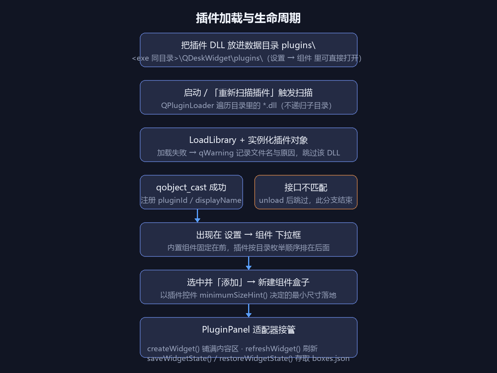

# QDeskWidget 组件插件编写指南

QDeskWidget 的组件（天气、音乐之外的第三类小组件）是**开放的**：写一个实现
`IWidgetPlugin` 接口的 DLL，放进数据目录的 `plugins\` 文件夹，它就会出现在
「设置 → 组件」的下拉框里，可以像内置组件一样新建、组合、折叠、持久化。

本指南基于仓库内的可编译示例 `plugins/hello-clock/`（一个走秒的时钟）写成，
复制那个目录改个 `pluginId` 就是你的第一个插件。



---

## 目录

- [快速开始](#快速开始)
- [接口参考](#接口参考)
- [控件编写规则](#控件编写规则)
- [状态持久化](#状态持久化)
- [CMake 构建模板](#cmake-构建模板)
- [安装与加载](#安装与加载)
- [排查清单：插件没出现 / 加载失败](#排查清单)

---

## 快速开始

**1. 复制示例目录**

```
plugins/hello-clock/          ← 复制，改名为你的组件，例如 plugins/my-todo/
├── CMakeLists.txt
├── HelloClockPlugin.cpp      ← 插件实现（接口类 + 控件类都在这一个文件里）
└── metadata.json             ← 给 Qt 读的元信息（构建时嵌进 DLL）
```

**2. 改四个必填点**

| 位置 | 改成 |
| --- | --- |
| `pluginId()` | 你的唯一 id：小写英文与连字符，如 `"my-todo"`（**发布后不要再改**，它写进 boxes.json 定位插件） |
| `displayName()` | 新建列表里显示的名字（建议 ≤ 10 个字） |
| `createWidget()` | 返回你自己的控件 |
| `widgetTitle()` | 标题栏文字（短一点，标题栏位置紧张） |

**3. 编译、放置、加载**

在仓库根目录正常构建即可（示例插件默认一起编译，POST_BUILD 会自动拷到
`<exe 同目录>\QDeskWidget\plugins\`）。对外发布时把你的 DLL 单独发给用户，
让他们放进同一个目录，然后：

- 重启程序，**或**
- 打开「设置 → 组件」→ 点「重新扫描插件」

之后在「设置 → 组件」下拉框里就能看到它（插件项排在内置组件后面），选中、点「添加」即可。

---

## 接口参考

接口头文件只有一个：`src/widgets/IWidgetPlugin.h`（纯头文件，不链接宿主任何库）。

### 必须实现

| 方法 | 返回 | 说明 |
| --- | --- | --- |
| `pluginId()` | `QString` | 唯一 id。写进 `boxes.json` 定位插件实现；**发布后不要改**，改了旧配置就找不到插件。建议格式：小写英文 + 连字符，如 `"hello-clock"` |
| `displayName()` | `QString` | 「设置 → 组件」下拉框里的名字。建议不超过 10 个字（菜单宽度有限） |
| `createWidget(QWidget *parent)` | `QWidget *` | 创建组件内容控件，宿主会把它**铺满内容区**。返回 `nullptr` 表示失败（宿主显示空面板） |
| `widgetTitle()` | `QString` | 标题栏文字。返回空串时宿主退回 `displayName()` |

### 可选覆写（有合理默认值）

| 方法 | 默认 | 说明 |
| --- | --- | --- |
| `description()` | 空串 | 下拉框选中时显示的一行说明 |
| `badgeCount()` | `-1` | 标题栏计数角标。非负数会显示成「N 项」；**负数 = 不显示** |
| `refreshWidget(QWidget *w)` | 空实现 | 菜单「刷新」时被调；耗时操作自己防重入（宿主不节流，用户可能连点） |
| `saveWidgetState(QWidget *w, QJsonObject &state)` | 空实现 | 把控件状态写进配置（落在 boxes.json 的 `widgetState`）。**只塞自己的键，不要 `clear()`** |
| `restoreWidgetState(QWidget *w, const QJsonObject &state)` | 空实现 | 从配置恢复状态。**首次创建时 state 可能是空对象，必须容忍缺字段** |

### 类声明三件套（缺一不可）

```cpp
class MyTodoPlugin : public QObject, public IWidgetPlugin
{
    Q_OBJECT                                        // ① 被 qobject_cast 的类必须带
    Q_PLUGIN_METADATA(IID QDeskWidgetPlugin_iid     // ② 指定 IID 与元信息文件
                      FILE "metadata.json")
    Q_INTERFACES(IWidgetPlugin)                     // ③ 声明实现的接口
public:
    QString pluginId() const override { return QStringLiteral("my-todo"); }
    QString displayName() const override { return QStringLiteral("待办清单"); }
    QString widgetTitle() const override { return QStringLiteral("待办"); }
    QWidget *createWidget(QWidget *parent) override { return new TodoWidget(parent); }
};
```

- **IID** 必须用宏 `QDeskWidgetPlugin_iid`（值为 `"com.qdeskwidget.IWidgetPlugin/1.0"`），
  不要自己写字符串。宿主升级接口版本（改 IID）时，旧 DLL 会统一加载失败，这是有意的。
- 接口类 `IWidgetPlugin` 本身**不继承 QObject**，所以插件类要写成
  `QObject + IWidgetPlugin` 双继承。

---

## 控件编写规则

宿主对控件只有三个承诺，其余全靠插件自理：

1. **铺满内容区**：宿主把 `createWidget()` 返回的控件 `setGeometry(rect())` 铺满，
   每次窗口尺寸变化都会重铺。控件内部想用布局就用，想自己 `resizeEvent` 摆子控件也行
   （示例时钟就是后者）。
2. **标题栏 / 玻璃背景 / 折叠 / 圆角由宿主绘制**：控件**不要画不透明底色**，
   否则会出现一块灰色矩形盖住玻璃。构造里加：
   ```cpp
   setAttribute(Qt::WA_NoSystemBackground);
   // 用 QSS 时也记得 background:transparent;
   ```
3. **回调都在 GUI 线程**：接口方法全部在宿主 GUI 线程调用，插件内部不要假设有其它线程；
   网络请求用 `QNetworkAccessManager` 的异步信号回主线程，不要开裸线程碰 UI。

### 尺寸：用 minimumSizeHint() 表达诉求

窗口的最小尺寸来自你控件的 `minimumSizeHint()`（拿不到再退 `sizeHint()`）：

- 想让窗口「最小也得这么大」→ 覆写 `minimumSizeHint()` 返回紧凑版式的尺寸下限；
- 返回无效值（≤ 0 或 > 4000，比如 `QWIDGETSIZE_MAX`）时该维退回默认 **170×110**，
  最后还会被夹一层 **140×80** 的硬下限——别指望报一个小值把窗口缩到极限；
- 宿主**不会**调用你的 `setFixedSize()`，一切尺寸都靠 hint 协商。

### 所有权与生命周期

- `createWidget()` **每次新建组件窗口都会调一次**，必须 `new` 新实例——
  返回单例/缓存控件会让多个窗口抢同一个 QWidget；
- 返回后所有权归宿主（父对象被设为宿主面板），**不要自己 delete**；
- 自己的定时器（QTimer）等子对象挂在该控件上即可，随控件一起销毁。

### 刷新

宿主没有全局定时器。需要周期刷新就**在控件里自己建 QTimer**（示例时钟 1 秒一跳）。
`refreshWidget()` 只在用户点菜单「刷新」时被调——把它实现成真正的重新取数，
而不是像示例那样演示切换显示秒。

---

## 状态持久化

`saveWidgetState()` / `restoreWidgetState()` 是插件的持久化通道，数据落在
`boxes.json` 里对应盒子的 `widgetState` 字段，重启、组合、折叠都不丢：

```cpp
void saveWidgetState(QWidget *w, QJsonObject &state) override
{
    if (auto *p = qobject_cast<TodoWidget *>(w))
        state[QStringLiteral("items")] = p->items();     // 直接塞键值，不要 clear
}

void restoreWidgetState(QWidget *w, const QJsonObject &state) override
{
    if (auto *p = qobject_cast<TodoWidget *>(w))
        p->setItems(state.value(QStringLiteral("items")).toArray());  // 缺字段要兜底
}
```

约定：

- `state` 是宿主备好的共享对象，可能残留旧版本写过的、你不认识的键——**只碰自己的键**；
- 读的一侧必须容忍缺字段/旧字段（首次创建时是空对象）；
- 注意 `refreshWidget()` 等回调里拿到的是 `QWidget *`，用 `qobject_cast` 转回你的类型
  （这也是控件类必须带 `Q_OBJECT` 的原因——没有它 `qobject_cast` 恒返回 nullptr）。

---

## CMake 构建模板

```cmake
cmake_minimum_required(VERSION 3.19)
project(MyTodoPlugin LANGUAGES CXX)

set(CMAKE_CXX_STANDARD 17)
set(CMAKE_CXX_STANDARD_REQUIRED ON)
set(CMAKE_AUTOMOC ON)                     # Q_OBJECT 的 moc 处理，必开

find_package(Qt6 6.5 REQUIRED COMPONENTS Core Gui Widgets)

add_library(MyTodoPlugin MODULE           # MODULE = 运行时插件，不是被链接的库
    MyTodoPlugin.cpp
)

target_include_directories(MyTodoPlugin PRIVATE
    <QDeskWidget 仓库>/src                # 为了 include widgets/IWidgetPlugin.h
)

target_link_libraries(MyTodoPlugin PRIVATE
    Qt6::Core Qt6::Gui Qt6::Widgets      # 插件只依赖 Qt，不链接宿主
)

if (MSVC)
    target_compile_options(MyTodoPlugin PRIVATE /utf-8 /Zc:__cplusplus /permissive-)
endif()

set_target_properties(MyTodoPlugin PROPERTIES
    PREFIX ""                            # 不要 lib 前缀，Windows 上直接是 MyTodoPlugin.dll
)
```

**在仓库内开发**（推荐）：直接复制 `plugins/hello-clock/`，在根 `CMakeLists.txt` 的
`add_subdirectory` 附近仿照它加一段，就能随主程序一起构建，POST_BUILD 自动拷到
数据目录的 `plugins\`。示例里还有一条值得保留：给源文件挂 `QDW_HEADER_STAMP`，
让 `IWidgetPlugin.h` 变动时插件也重编（只对 MSVC 的 NMake 工程有意义）。

**关于 `.moc`**：如果你的接口类和控件类都写在 `.cpp` 里（示例就是这么做的），
`.cpp` 不会被 moc 单独处理，文件**末尾必须加**：

```cpp
#include "MyTodoPlugin.moc"   // 文件名 = 当前 cpp 文件名
```

漏了它会在链接期报 vtable / 信号相关的错误。

---

## 安装与加载

| 项 | 值 |
| --- | --- |
| 插件目录 | `<exe 同目录>\QDeskWidget\plugins\`（设置 → 组件 →「打开插件目录」可直接打开） |
| 扫描方式 | 只认目录下的 `*.dll`，**不递归子目录**（插件依赖的第三方 DLL 放子目录或 exe 目录都行） |
| 生效时机 | 重启程序，或「设置 → 组件 → 重新扫描插件」 |
| 显示位置 | 「设置 → 组件」下拉框，内置组件（天气/音乐）固定在前 |
| 右键菜单 | 组件窗口右键会多出「刷新」和灰色的「插件：xxx」（显示 pluginId，便于定位是哪个 DLL） |

`metadata.json` 是给 Qt 读的插件元信息（`Q_PLUGIN_METADATA(FILE "metadata.json")`），
构建时嵌进 DLL，**改名或挪位置会导致编译失败**；里面的 `name/version/author` 等字段
宿主不读，仅供人看。

---

## 排查清单

**插件没出现在下拉框里**，按命中率从高到低查：

1. **debug / release 混用**（最常见的「加载失败」）。插件必须与宿主用**同一种配置**编译：
   Debug 主程序只认 Debug 插件，Release 主程序只认 Release 插件，混用会被 Qt 直接拒绝，
   日志报 `uses incompatible Qt library. (Cannot mix debug and release libraries.)`。
   给用户的发行版插件请用 **Release** 编译。
2. **Qt 版本 / 编译器不一致**。插件必须和宿主用同一套 Qt（同大版本）、同编译器与运行库
   （MSVC 主程序配 MSVC 插件，MinGW 同理），否则 `instance()` 直接返回 nullptr。
3. **三件套缺失**。`Q_OBJECT` / `Q_PLUGIN_METADATA` / `Q_INTERFACES` 少任何一个，
   `qobject_cast<IWidgetPlugin*>` 都会失败，日志只看到「不是 IWidgetPlugin」。
4. **IID 不对**。`Q_PLUGIN_METADATA(IID ...)` 必须用 `QDeskWidgetPlugin_iid` 宏。
5. **`.moc` 没包含**（`.cpp` 内定义 QObject 子类时）。
6. **目录不对**。DLL 要放在 `<exe 同目录>\QDeskWidget\plugins\`，不是 exe 旁边，
   也不是别的盘符路径；放好后记得「重新扫描插件」或重启。

**加载成功了但窗口是空的 / 刷新没反应**：

- 控件类少了 `Q_OBJECT`（`qobject_cast` 恒 nullptr，回调全部静默失效）；
- `createWidget()` 返回了 nullptr；
- 控件画了不透明底色把玻璃盖住，看起来像空的。

**怎么看加载日志**：宿主对每个 DLL 的加载结果都会打日志（`[plugin] 已加载 …` /
`[plugin] xxx 加载失败: 原因` / `[plugin] xxx 不是 IWidgetPlugin`）。GUI 程序下
qWarning 默认走系统调试器（DebugView / VS 输出窗口可见）；带控制台启动或设置
`QT_LOGGING_TO_CONSOLE=1` + `QT_DEBUG_PLUGINS=1` 可以把 Qt 插件系统的完整诊断打到 stderr。

---

## 接口稳定性

- `IWidgetPlugin` 当前版本：`com.qdeskwidget.IWidgetPlugin/1.0`。
- 宿主升级接口时**会换 IID**，旧 DLL 统一失效（而不是行为未定义），届时按新版
  `IWidgetPlugin.h` 重编一次即可。
- `pluginId` 是你与宿主之间的永久契约：内容、行为都可以改，id 不要改。

---

*本文档对应源码：`src/widgets/IWidgetPlugin.h`（接口）、
`src/widgets/WidgetRegistry.cpp`（扫描与适配）、`plugins/hello-clock/`（完整示例）。*
